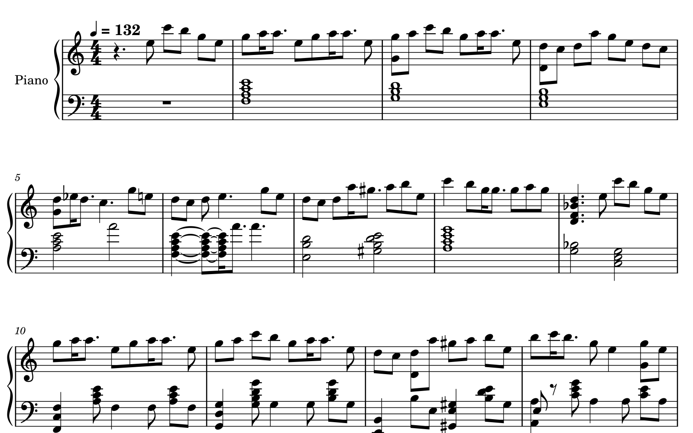
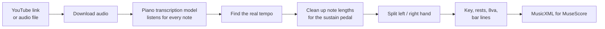

<div align="center">

# 🎹 piano-to-sheet

### No sheet music? Make your own.

**Paste a YouTube link to a piano video. Get sheet music you can open, print, and play.**

[](https://www.python.org/)
[](https://musescore.org/)
[](#-how-good-is-it)
[](#-how-good-is-it)
[](LICENSE)



<sub>The first 13 bars of <i>Halzion</i>, straight out of piano-to-sheet: two hands, real tempo, key changes, no manual edits.</sub>

</div>

---

I wanted to learn YOASOBI's *Halzion* on piano. [fruit 果's arrangement](https://www.youtube.com/watch?v=XFEgigNIfKg) is beautiful, and someone had even made a [falling-notes video of it](https://www.youtube.com/watch?v=y_Y30_RQUrs). But there was no sheet music anywhere, free or paid.

So I built this. It listens to a piano recording (any YouTube video, falling-notes or not), works out every note, and writes a proper two-handed score: real tempo, key signature, and 8va markings, so it reads like sheet music and not a wall of notes.

Here's [the full story](https://nelsonsiu.fun/writing/halzion) and [the Halzion score it made](https://musescore.com/user/39208584/scores/37886330).

## 🚀 Quick start

**1. Install the two system tools** (one time):

```bash
brew install ffmpeg            # macOS. On Ubuntu/Debian: sudo apt install ffmpeg
```

Also install [MuseScore 4](https://musescore.org/en/download) (free) to open the result.

**2. Get the code and its Python packages** (one time):

```bash
git clone https://github.com/nelonmelons/piano-to-sheet.git
cd piano-to-sheet
python3 -m venv .venv && source .venv/bin/activate
pip install -r requirements.txt
```

**3. Make sheet music:**

```bash
python yt2score.py "https://www.youtube.com/watch?v=XFEgigNIfKg"
```

The first run also downloads the transcription model (~170 MB, once). When it's done you'll see:

```
MusicXML: out/halzion-yoasobi-piano/halzion-yoasobi-piano.musicxml
```

**4. Open that `.musicxml` file in MuseScore.** Done. From there you can play it back, print it, or export a PDF.

> 💡 Open the `.musicxml`, not the `.mid`. MuseScore re-splits MIDI files by pitch and loses the hand assignment.

### Got a video or audio file instead of a link?

```bash
python yt2score.py ~/Downloads/my-song.mp4      # .mp4, .mp3, .wav, .m4a all work
```

## 🎛️ Useful options

| Flag | What it does |
|---|---|
| `--title "My Song"` | Sets the score title (defaults to the video title or file name) |
| `--bpm 120` | Forces the tempo if the detected one looks off (e.g. everything is in double-time) |
| `--render` | Also saves PNG pages of the score (needs MuseScore 4 installed) |
| `--out-dir scores/` | Puts the output somewhere else |
| `--skip-transcribe` | Re-runs only the cleanup, reusing the notes from the last run (fast) |

**Best results:** solo piano with no singing or drums. Falling-notes videos and "piano cover" videos are ideal. A song with a full band will give you a messy score.

## 🧠 How it works



A raw transcription is a list of notes and times, and if you open it as-is it looks awful. Most of the work here is turning that list into something a person can read:

- **Real tempo.** Raw output is written at a fake 120 BPM. piano-to-sheet tries tempos and picks the one where notes land on the beat grid (99% of *Halzion*'s notes land on the grid at 132 BPM, vs 52% at 130).
- **The sustain pedal.** The model hears how long a note *rings*, and the pedal keeps notes ringing for ages. Taken literally, every note overlaps. Notes are shortened, then stretched back out only until that hand's next note.
- **Two hands.** A search over playable hand positions (hand span, five fingers per hand, jump distance) decides which notes go on which staff.
- **Reading niceties.** It works out the key bar by bar (so key changes show up), adds 8va/8vb brackets for high or low passages, and snaps everything cleanly to bar lines so MuseScore never calls the file "corrupted".

## 📏 How good is it?

I graded it on *Halzion* against notes read pixel-by-pixel off the [falling-notes video](https://www.youtube.com/watch?v=y_Y30_RQUrs), which shows exactly when each key is pressed:

| | Result |
|---|---|
| Notes found | **95.8%** |
| Average timing error | **3.9 ms** |
| Notes on the beat grid | **99.1%** |
| Speed | ~67 s for a 3.6 min song (M4 Pro, CPU only) |

It also found a few hundred notes the video reader missed, mostly fast repeated notes that blur together on screen.

## 🎞️ Advanced: read a falling-notes video directly

`video2midi.py` skips audio entirely and reads the colored bars off a Synthesia-style video, frame by frame. When it's tuned to a video, it's frame-accurate: all 52 onsets I spot-checked matched the frame where the key lights up, to within a millisecond.

```bash
python video2midi.py calibrate    # finds the 88 keys  -> calibration.png
python video2midi.py detect       # tracks the bars    -> notes.json
python video2midi.py export --format musicxml --bpm 132
```

The catch: it's tuned to one video's layout. The constants at the top of `video2midi.py` (keyboard position, hit line, bar colors, scroll speed) were measured for a 1080p video with a full 88-key keyboard. For another video, look at `calibration.png` and adjust them. For most people, the audio route above is easier.

## ⚠️ Known gaps

- Very dense passages can confuse the left/right hand split.
- The left hand doesn't switch clef, so its high passages show up in bass clef with ledger lines.
- Only piano. Other instruments in the mix will show up as wrong notes.

## 🙏 Credits

- Transcription model: [ByteDance piano_transcription](https://github.com/bytedance/piano_transcription) (Kong et al., 2021) via [piano_transcription_inference](https://github.com/qiuqiangkong/piano_transcription_inference)
- *Halzion* piano arrangement: [fruit 果](https://www.youtube.com/watch?v=XFEgigNIfKg). Falling-notes transcription: [Kai Ichinose](https://www.youtube.com/watch?v=y_Y30_RQUrs)
- Score engraving: [music21](https://github.com/cuthbertLab/music21) and [MuseScore](https://musescore.org/)

Please respect arrangers' rights: share scores you make for personal practice, and credit the arranger.
